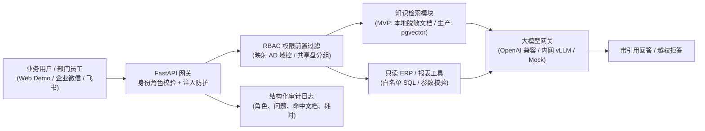

# Enterprise AI Ops Agent

> **企业内网级权限隔离知识库与 ERP/报表问答智能体（PoC 与工程交付参考实现）**

面向制造、贸易与多部门协作型企业的私有化 AI 落地原型。针对企业真实痛点——**共享盘文档分散、跨部门权限越权风险、业务查报表高频依赖 IT**——提供「部门级 RBAC 权限前置过滤 + 可追溯引用 + 越权拒答 + 审计日志 + 一键容器化部署」的端到端交付参考。

---

## 一、方案架构（私有化 / 混合云部署视角）



---

## 二、核心能力与安全边界

| 能力维度 | 当前 MVP 已实现 | 生产演进规划 |
|---|---|---|
| **权限隔离（RBAC）** | 检索前强制按部门角色过滤文档（`public` / `finance` / `procurement` / `it_admin`），杜绝把无权文档送入模型上下文 | 对接企业 AD 域控 / LDAP / 钉钉飞书组织架构 |
| **安全与防注入** | 输入长度限制、常见 Prompt Injection 规则拦截、无权访问自动拒答 | 接入语义级护栏模型与敏感词脱敏网关 |
| **可追溯与审计** | 每次问答返回引用文档 ID/标题，并生成结构化审计记录 | 接入 OpenTelemetry / Langfuse 与数据库持久化审计 |
| **工程可维护性** | 强类型配置校验、离线可跑的 `pytest` 单测、Ruff 静态检查、GitHub Actions CI | 接入 pgvector 混合检索 + Rerank + 自动化评测流水线 |
| **现场演示能力** | 内置极简交互演示页（`GET /`），支持一键切换部门角色现场演示权限隔离 | 集成只读 ERP 报表查询与图表可视化 |

### 内置角色权限矩阵（演示用）

| 角色 ID | 角色名称 | 可访问文档范围 |
|---|---|---|
| `employee` | 普通员工 | 仅 `public`（通用 IT/办公指南） |
| `finance` | 财务组 | `public` + `finance`（报销审批与对账 SOP） |
| `procurement` | 采购组 | `public` + `procurement`（供应商准入与采购 SOP） |
| `it_admin` | IT 管理员 | 全部演示文档（`public` + `finance` + `procurement`） |

---

## 三、5 分钟快速复现

### 方式 A：本地运行（Windows PowerShell）

> 要求：Python `>= 3.11`（不填真实 API Key 也可直接运行离线单元测试与内置 Mock 演示模式）。

```powershell
# 1. 创建并激活虚拟环境
py -3 -m venv .venv
.\.venv\Scripts\Activate.ps1

# 2. 安装项目与开发依赖
pip install -e ".[dev]"

# 3. 复制环境变量模板（默认 LLM_PROVIDER=mock，无需真实 Key）
Copy-Item .env.example .env

# 4. 运行离线单元测试（验证配置校验、权限隔离、注入拦截与 API）
pytest tests/unit

# 5. 启动服务并打开演示页面
uvicorn ops_agent.main:app --reload --port 8000
```

启动后访问：
- 交互演示页：`http://127.0.0.1:8000/`（可直接切换部门角色测试权限隔离）
- Swagger API 文档：`http://127.0.0.1:8000/docs`
- 健康检查：`http://127.0.0.1:8000/health`

### 方式 B：Docker Compose 一键启动（含 pgvector）

```powershell
docker compose up --build
```

---

## 四、目录结构

```text
enterprise-ai-ops-agent/
├── .github/workflows/ci.yml        # GitHub Actions：Ruff + 离线单测
├── data/
│   ├── README.md                   # 数据合规声明（100% 合成脱敏数据）
│   └── sample_docs/                # 演示用脱敏 SOP 文档
├── docs/
│   ├── solution_proposal.md        # 售前解决方案书（架构、权限、实施周期、ROI）
│   └── poc_eval_report.md          # PoC 评测报告模板
├── src/ops_agent/
│   ├── config.py                   # 环境变量与边界强校验
│   ├── rbac.py                     # 部门权限矩阵、注入拦截与审计记录
│   ├── knowledge.py                # 权限前置过滤的轻量检索器
│   └── main.py                     # FastAPI 接口与内置演示页
├── tests/unit/                     # 离线单元测试（无 Key 依赖）
├── Dockerfile
├── docker-compose.yml
├── .env.example
└── pyproject.toml
```

---

## 五、PoC 评测指标（持续更新）

> 说明：以下指标仅记录真实运行结果，未跑完整 LLM 评测集前保持 `待实测`，不虚构数据。

| 指标 | 定义 | 当前状态 |
|---|---|---|
| 离线单元测试通过率 | `pytest tests/unit`（配置校验 + RBAC + 注入拦截 + API） | ✅ 本地可验证 |
| 越权访问拦截率 | 低权限角色提问高权限文档时的正确拒答比例 | `待实测（30 题固定集）` |
| 检索 Recall@5 | Top-5 召回片段包含标准答案文档的比例 | `待接入 pgvector 后实测` |
| P95 端到端延迟 | 从请求进入到返回完整结果的 95 分位耗时 | `待接入真实模型后实测` |
| 单次问答平均成本 | 平均 Token 消耗折算单次查询成本 | `待接入真实模型后实测` |

---

## 六、相关文档与已知限制

- 售前与实施架构方案：[docs/solution_proposal.md](docs/solution_proposal.md)
- PoC 验收评测报告模板：[docs/poc_eval_report.md](docs/poc_eval_report.md)
- **当前限制**：现版本为 MVP 骨架，检索层默认基于本地脱敏 Markdown 关键词匹配、模型层默认 `mock` 模式；下一步将接入 `pgvector` 混合检索、OpenAI 兼容大模型客户端以及只读 SQL 报表查询工具。
