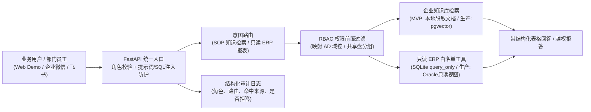

# Enterprise AI Ops Agent

[](https://github.com/aoguo1102/enterprise-ai-ops-agent/actions/workflows/ci.yml)


> **企业内网级权限隔离知识库与只读 ERP 报表问答智能体（PoC 与工程交付参考实现）**

面向制造、贸易与多部门协作型企业的私有化 AI 落地原型。针对企业真实痛点——**共享盘文档分散、跨部门权限越权风险、业务查 ERP 报表高频依赖 IT**——提供「部门级 RBAC 权限前置过滤 + 只读 ERP 报表白名单查询 + 可追溯引用 + 越权拒答 + 审计日志 + 一键容器化部署」的端到端交付参考。

---

## 一、方案架构（私有化 / 混合云部署视角）



---

## 二、核心能力与安全边界

| 能力维度 | 当前 MVP 已实现 | 生产演进规划 |
|---|---|---|
| **权限隔离（RBAC）** | 知识检索与 ERP 工具调用前均强制按部门角色过滤（`public` / `finance` / `procurement` / `it_admin`），杜绝无权数据进入上下文 | 对接企业 AD 域控 / LDAP / 钉钉飞书组织架构 |
| **只读 ERP 报表工具** | 内置 3 个白名单参数化只读工具（低库存预警 / 逾期应付账款 / 采购订单汇总），SQLite 强制 `PRAGMA query_only = ON`，**永不执行用户原始 SQL** | 对接生产 Oracle / PostgreSQL 只读账号与受控报表视图 |
| **安全与防注入** | 输入长度限制、Prompt Injection 与高危 SQL（`DROP/DELETE/UPDATE`）规则拦截、越权自动拒答 | 接入语义级护栏模型与敏感字段脱敏网关 |
| **可追溯与审计** | 每次问答返回路由类型、引用文档/表来源与结构化审计记录 | 接入 OpenTelemetry / Langfuse 与数据库持久化审计 |
| **大模型网关（DeepSeek）** | 零外部重依赖 OpenAI 兼容客户端（默认支持 DeepSeek `deepseek-chat`，也可切通义千问/Ollama/vLLM），含超时、429/5xx 指数退避重试、Token 成本估算与上游故障自动降级 | 接入流式 SSE 输出与多模型路由 |
| **工程与现场演示** | 离线 `pytest` 单测、Ruff 静态检查、30 题固定评测集（CI 自动跑 Mock 基线）、内置可视化演示页（含模型用量/成本标签与报表渲染） | 接入 `pgvector` 混合检索 + Rerank |

### 内置角色权限矩阵（SOP 文档 + ERP 报表）

| 角色 ID | 角色名称 | 可访问 SOP 文档 | 可调用只读 ERP 工具 |
|---|---|---|---|
| `employee` | 普通员工 | `public`（共享盘与办公网指南） | `query_inventory_alerts`（公共低库存预警） |
| `finance` | 财务组 | `public` + `finance`（报销与月结 SOP） | 库存预警 + `query_ap_overdue_summary`（应付账款 AP） |
| `procurement` | 采购组 | `public` + `procurement`（供应商与比价 SOP） | 库存预警 + `query_purchase_orders`（采购订单 PO） |
| `it_admin` | IT 管理员 | 全部演示 SOP 文档 | 全部 3 个只读 ERP 报表工具 |

---

## 三、5 分钟快速复现

### 方式 A：本地运行（Windows PowerShell）

> 要求：Python `>= 3.11`（默认离线 Mock 与内存只读 SQLite 模式，**无需填写真实 API Key 即可跑通全部单测与可视化演示页**）。

```powershell
# 1. 创建并激活虚拟环境
py -3 -m venv .venv
.\.venv\Scripts\Activate.ps1

# 2. 安装项目与开发依赖
pip install -e ".[dev]"

# 3. 复制环境变量模板（默认 mock 免 Key；如需接入 DeepSeek，在 .env 中设置 LLM_PROVIDER=deepseek 并填入 LLM_API_KEY）
Copy-Item .env.example .env

# 4. 运行离线单元测试与 30 题固定基线评测
pytest tests/unit
python evals/run_eval.py --provider mock

# 5. 如已配置 DeepSeek API Key，先小样本 5 题试跑验证，再跑全量 30 题评测
# python evals/run_eval.py --provider deepseek --limit 5
# python evals/run_eval.py --provider deepseek

# 6. 启动服务并打开演示页面
uvicorn ops_agent.main:app --reload --port 8000
```

启动后访问：
- 交互演示页：`http://127.0.0.1:8000/`（一键切换部门角色，现场演示 SOP 问答 + ERP 结构化报表 + 越权拦截）
- Swagger API 文档：`http://127.0.0.1:8000/docs`
- 只读 ERP 工具清单：`http://127.0.0.1:8000/api/v1/erp/tools`
- 健康检查：`http://127.0.0.1:8000/health`

### 方式 B：Docker Compose 一键启动（含 pgvector）

```powershell
docker compose up --build
```

---

## 四、目录结构

```text
enterprise-ai-ops-agent/
├── .github/workflows/ci.yml        # GitHub Actions：Ruff + 离线单测
├── data/
│   ├── README.md                   # 数据合规声明（100% 合成脱敏数据）
│   └── sample_docs/                # 演示用脱敏 SOP 文档
├── docs/
│   ├── solution_proposal.md        # 售前解决方案书（架构、权限、实施周期、ROI）
│   └── poc_eval_report.md          # PoC 评测报告模板
├── evals/
│   ├── dataset.jsonl               # 30 题固定评测集（15 授权 + 8 越权 + 4 注入 + 3 库外）
│   └── run_eval.py                 # 评测运行脚本（支持 mock / deepseek / --limit 小样本试跑）
├── src/ops_agent/
│   ├── config.py                   # .env 读取、环境变量与边界强校验
│   ├── rbac.py                     # 部门权限矩阵、提示词/SQL注入拦截与审计记录
│   ├── knowledge.py                # 权限前置过滤的企业知识检索器
│   ├── erp_tools.py                # 白名单只读 ERP 模拟库（PRAGMA query_only）与报表工具
│   ├── llm_client.py               # DeepSeek / OpenAI 兼容客户端（超时、重试、Token 与成本统计）
│   ├── pipeline.py                 # 安全前置编排管线（拒答题 0 模型调用 + 故障自动降级）
│   └── main.py                     # FastAPI 统一路由与内置可视化演示页
├── tests/unit/                     # 离线单元测试（无 Key 依赖）
├── Dockerfile
├── docker-compose.yml
├── .env.example
└── pyproject.toml
```

---

## 五、PoC 评测指标（持续更新）

> 说明：以下指标仅记录真实运行结果，未跑完整 LLM 评测集前保持 `待实测`，不虚构数据。

| 指标 | 定义 | 离线基线实测（`mock`） | DeepSeek 实测（`deepseek-chat`） |
|---|---|---:|---:|
| CI 静态检查与离线单测 | `ruff check src tests evals` + `pytest tests/unit` | ✅ CI 自动验证 | — |
| 30 题固定集总通过率 | 15 授权 + 8 越权 + 4 注入 + 3 库外 | **100.0% (30/30)** | **96.67% (29/30)** |
| 越权与注入前置拦截率 | 权限/注入拦在调模型前（拒答题 **0 次模型调用**） | **100.0% (12/12)** | **100.0% (12/12，0 Token)** |
| 知识库外拒答率 | 3 题无关问题诚实拒答 | **100.0% (3/3)** | **100.0% (3/3，0 Token)** |
| 授权来源引用准确率 | 命中正确 SOP 文档 ID 或只读 ERP 表 | **100.0% (15/15)** | **100.0% (15/15)** |
| P95 延迟（全量 / 仅调模型） | 30 题全量 P95 / 15 题调用 DeepSeek P95 | **0.18 ms** | **5,635.75 ms / 5,712.74 ms** |
| 单次授权问答平均成本 | 按 `deepseek-chat` 参考费率（15 次共 5,308 Token） | **¥0** | **¥0.001162（约 ¥1.16 / 千次）** |

> 真实失败案例复盘（`Q09`）与完整评测明细见 [docs/poc_eval_report.md](docs/poc_eval_report.md)。

---

## 六、相关文档与已知限制

- 售前与实施架构方案：[docs/solution_proposal.md](docs/solution_proposal.md)
- PoC 验收评测报告模板：[docs/poc_eval_report.md](docs/poc_eval_report.md)
- **当前限制**：现版本为可独立演示的离线 MVP（知识检索采用本地脱敏文档、ERP 工具采用内存只读 SQLite 合成数据）；下一步将接入 OpenAI 兼容大模型客户端、`pgvector` 混合检索以及 30 题固定评测脚本。
